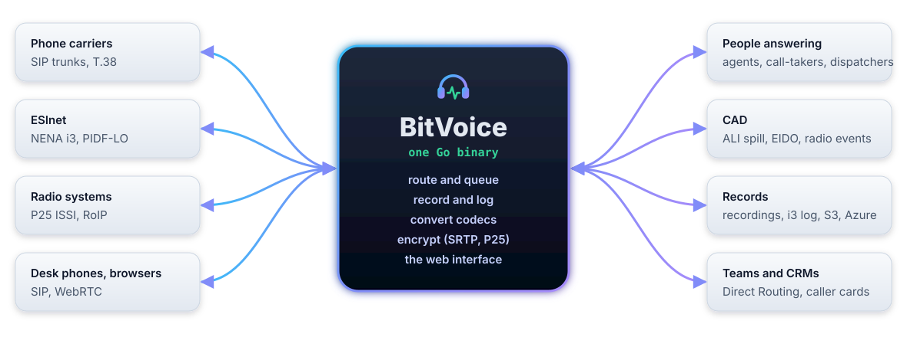
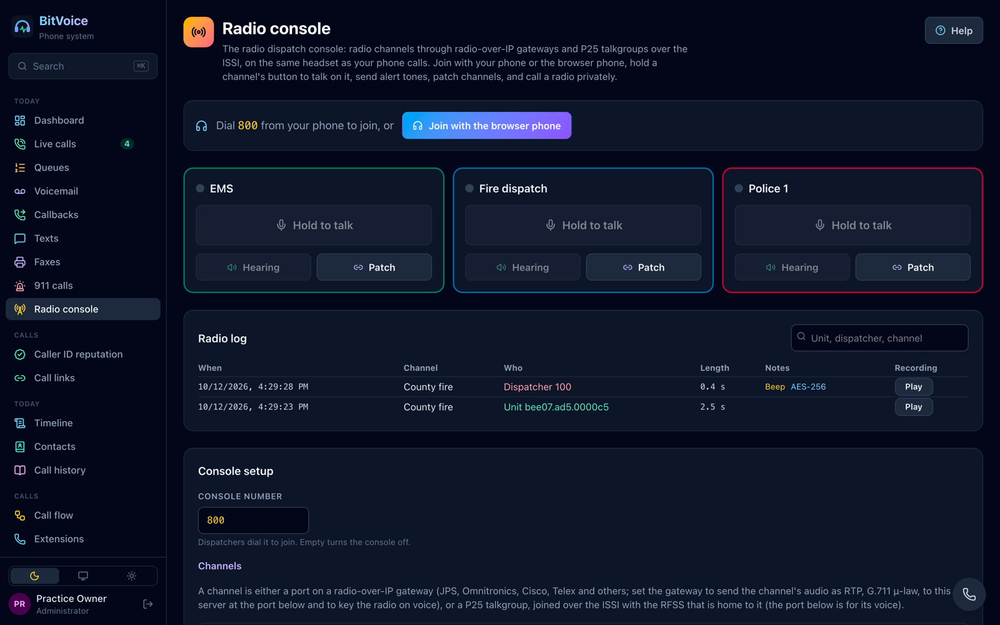
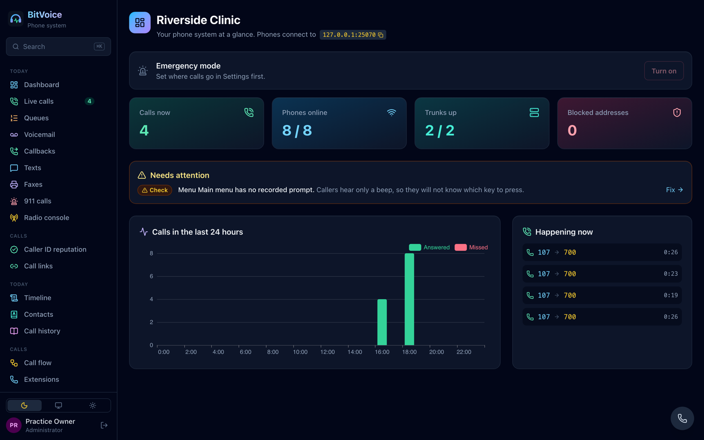
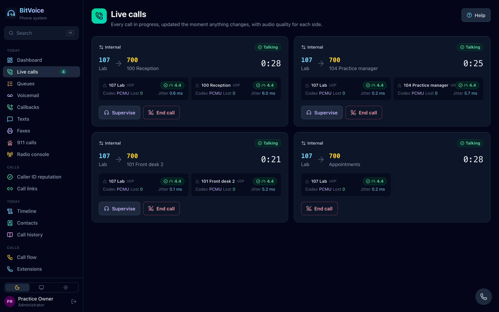
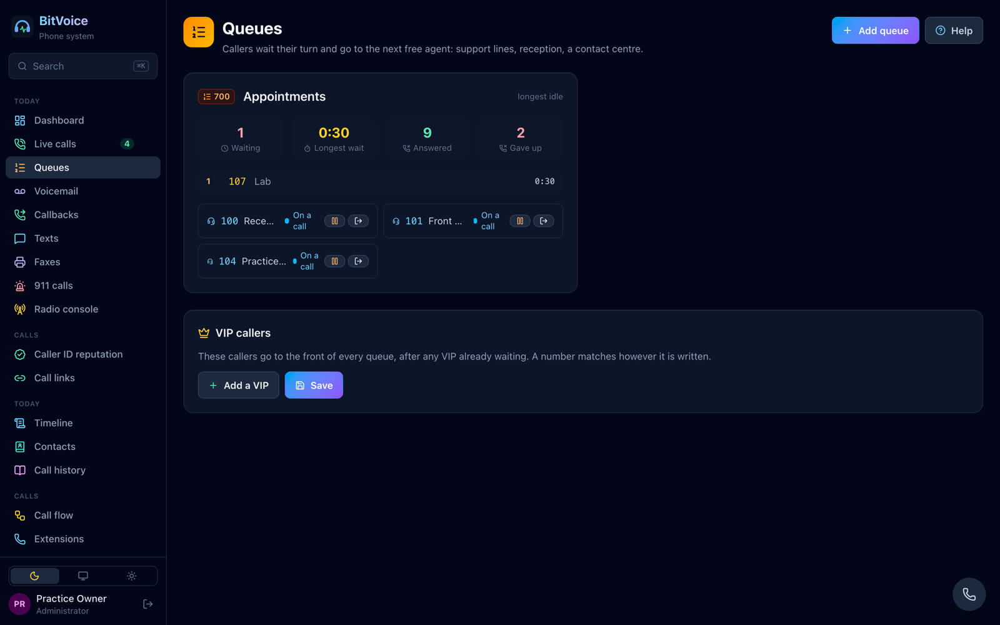
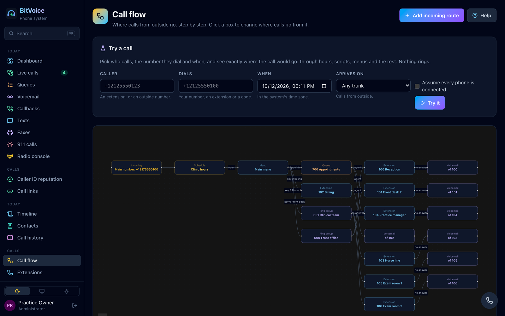
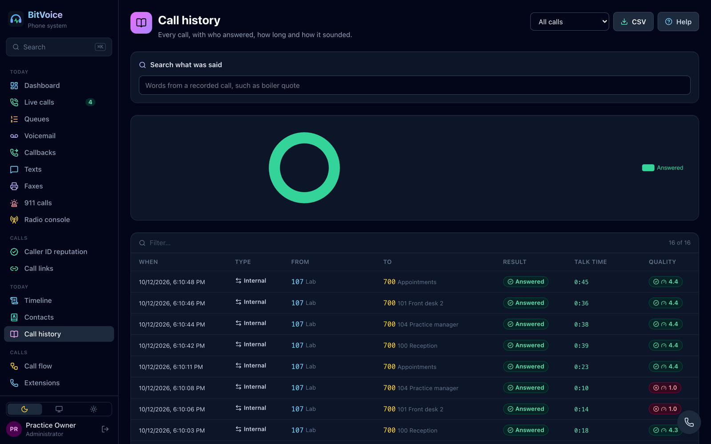
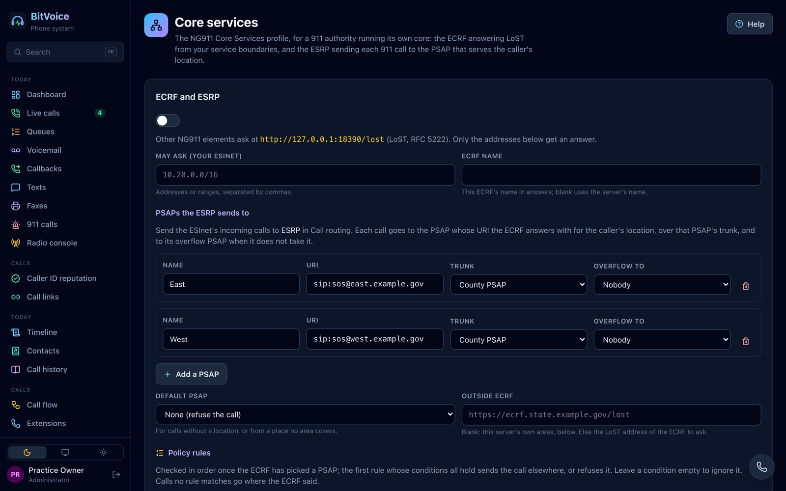

<div align="center">


<h1></h1>

### An open-source, single-binary alternative to FreePBX and Asterisk

**A complete, Apache-2.0 licensed phone system for offices, contact centres and hosted providers, run
100% from its web interface.** No Asterisk or FreeSWITCH underneath. No configuration files to edit. No
paid modules. No licence meter.

**Website: [bitvoice.org](https://bitvoice.org)**

**One 37 MB file. 47 MB of memory carrying four live calls and eight phones.** Double-click it and a
browser opens on a setup wizard; a few minutes later a phone rings.

[](LICENSE) [](https://go.dev) [](#download) [](#download) [](https://github.com/BioDream-LLC/bitvoice/actions/workflows/ci.yml)

<a href="https://demo.bitvoice.org"></a>

<sub><b>Sign in as</b> <code>demo</code> <b>with password</b> <code>try-bitvoice-demo</code> · then open the browser phone as extension <code>150</code>, password <code>try-the-demo-phone</code>, and dial <code>810</code> or <code>*43</code> · an invented business, reset every night · look at everything, change nothing · or <a href="docs/assets/tour.mp4">watch the tour</a> (2½ minutes)</sub>

### Download v0.1.13

<a href="https://github.com/BioDream-LLC/bitvoice/releases/download/v0.1.13/bitvoice-v0.1.13-linux-amd64.tar.gz"></a>&nbsp;<a href="https://github.com/BioDream-LLC/bitvoice/releases/download/v0.1.13/bitvoice-v0.1.13-darwin-arm64.tar.gz"></a>&nbsp;<a href="https://github.com/BioDream-LLC/bitvoice/releases/download/v0.1.13/bitvoice-v0.1.13-windows-amd64.zip"></a>

<a href="https://biodream-llc.github.io/bitvoice/manual/"></a>

<sub>One file, nothing to install. [ARM64 Linux and Windows, Intel Macs and checksums](#download)</sub>

[**Website**](https://bitvoice.org) · [**Quick start**](#quick-start) · [**Everything it does**](#everything-it-does) · [**Public safety (lab)**](#public-safety-lab-and-design-partner-track) ·
[**What it looks like**](#what-it-looks-like) · [**Manual**](https://biodream-llc.github.io/bitvoice/manual/) ·
[**Manual (PDF)**](docs/manual/bitvoice-manual.pdf) · [**FAQ**](#faq)

</div>

---

## What is BitVoice?

**BitVoice is a phone system packaged like an appliance:** one binary, one built-in web interface, no
outside runtime, and still a REST API and configuration in Git for those who want them. Underneath is its
own Go engine: SIP and IAX2, RTP and SRTP, a media engine with codec conversion, and WebRTC. Calls arrive,
wait in queues, ring phones and browsers, are recorded and logged, and reach the people who answer them.

**100% in the web interface.** That is the first rule of the project. Setup, extensions, phones, routing,
queues, trunks, updates and rollback, diagnostics: every setting has a screen, and a feature that can only be
reached through a file or a command line is treated as a bug. Every screen has a chapter in the manual and
automated browser tests. Telecom administrators run it without being developers; developers automate the
same screens through the API.

It runs as:

- **A phone system** for offices and businesses: extensions, ring groups, queues, menus, voicemail to
  email, recording, conference rooms, forwarding and follow-me, a staff portal, desk-phone set-up, a
  browser phone, SIP and IAX2 trunks, and an import from FreePBX, Asterisk, 3CX, Cisco, Avaya and Mitel.
- **A hosted phone service:** many organisations on one server, each with its own extensions, numbers,
  administrators and web address, and limits on what each may use.
- **A contact centre:** queues with a live wallboard, callbacks, VIP and sticky routing, supervisors
  listening in, transcripts and summaries, caller cards from your CRM.

**Built to a 911 reliability bar.** Routing scripts and integrations can never lose or hold up a call: each
has a time limit and a fixed outcome when it fails. Emergency calls from every extension always go out,
with the caller's building, floor and room.

**Two missions.** BitVoice is built for two jobs, and neither is a side project:

1. **A standalone phone system that beats FreePBX, Asterisk and their rivals.** Everything above, with no
   911 parts needed or shown: a business that only wants a phone system never sees them.
2. **The call-handling side of BioDream's open-source CAD, bitdispatcher.** The same engine carries a 911
   answering-point profile, a P25 radio dispatch console and NG911 Core Services, and hands the CAD what it
   needs through the standards: EIDO incidents with links to the caller's photos and video, ALI spill,
   PIDF-LO location, live video by WHEP, radio emergencies and unit positions, the i3 log. They are built and
   tested against recorded captures, NENA's published schemas, sample data and stand-ins, **not certified and
   not yet tried with a live ESInet or P25 system**. They stay off the menu until switched on in Settings; see
   [Public safety: lab and design-partner track](#public-safety-lab-and-design-partner-track).



## Everything it does

Eleven areas of the phone system, itemised; the public-safety lab track [follows](#public-safety-lab-and-design-partner-track).
Where something has only been tested against stand-ins rather than real equipment, [it says so](#how-it-is-tested).

<table width="100%">
<thead><tr><th align="left" valign="middle" width="176"></th><th align="left" valign="middle">Everything an office phone system does</th></tr></thead>
<tbody>
<tr><td colspan="2"><b>Extensions</b> with voicemail, call recording, an emergency location (site, floor and room) and what happens when nobody answers</td></tr>
<tr><td colspan="2"><b>Ring groups</b> and <b>auto-attendant menus</b>, with extensions dialled directly from the menu</td></tr>
<tr><td colspan="2"><b>Schedules</b>: opening hours and holidays, with a different destination for open and closed</td></tr>
<tr><td colspan="2"><b>Voicemail</b>: greetings recorded in the browser, <code>*97</code>, message-waiting lamps, the message emailed with its recording</td></tr>
<tr><td colspan="2">Hold, <b>blind and attended transfer</b>, call parking, <b>paging</b> and overhead speakers, busy lamps (BLF)</td></tr>
<tr><td colspan="2"><b>SIP trunks</b> over UDP, TCP or TLS, with registration, channel limits and failover between trunks</td></tr>
<tr><td colspan="2"><b>IAX2 trunks</b> (RFC 5456) to Asterisk and FreePBX servers and IAX2 providers, registering either way, with call tokens; tested against Asterisk 23</td></tr>
<tr><td colspan="2"><b>Call routing</b> by dial pattern, with prefixes added or digits removed, and 911 always allowed from every extension</td></tr>
<tr><td colspan="2"><b>Office 911</b> for every profile: Kari's Law notification, RAY BAUM'S Act building, floor and room, remote workers asked to confirm where they are</td></tr>
<tr><td colspan="2"><b>Scripts in JavaScript or Lua</b> that route calls, or <b>run whole calls</b> (play, say, collect keys, record, ring people, transfer, hang up), sandboxed and time-limited, with a fixed fallback if a script fails</td></tr>
<tr><td colspan="2">A <b>call flow diagram</b> of where calls go, and a <b>call-path simulator</b>: pick a caller, number and time and see the exact route, without ringing anything</td></tr>
<tr><td colspan="2"><b>Check every situation</b>: the whole call plan tried in every combination of hours over the coming year, toggles, menu keys and no-answers, and every extension dialling 911, listing calls that end nowhere, loops, dead branches and emergency calls resting on one trunk, each with the situation that shows it; the same check runs on a change before it is made</td></tr>
<tr><td colspan="2"><b>Every call says how it was routed</b>, in plain words on its record: the route, the hours, toggles, scripts, keys, forwards and trunks that decided it</td></tr>
<tr><td colspan="2"><b>Forwarded calls keep their history</b>: SIP History-Info (RFC 7044) and Diversion read from carriers and Teams and sent on forwards out, so voicemail and the next system know who was really called</td></tr>
<tr><td colspan="2"><b>Judges that give their reasons</b>: a <b>toll-fraud guard</b> on every call abroad (first call to a country, out of hours, from outside, bursts, attacks; never an emergency call), a <b>trunk health judge</b> that tells a provider that is down from your own link being down, and a call-quality diagnosis that compares both halves of each call. Each follows a rulebook checked in every combination of its facts; something not measured is never taken for safe</td></tr>
<tr><td colspan="2"><b>Video calls</b> between phones that both send video, relayed and encrypted like the sound</td></tr>
<tr><td colspan="2"><b>Hot desking</b> (<code>*33</code>), a company directory on every phone, calendar-driven do not disturb from Outlook and Google</td></tr>
<tr><td colspan="2"><b>Conference rooms</b> with a PIN and a leader PIN, wait for the leader, members joining muted (press 1 to ask to speak), lock, recording, and a live view to mute or remove people</td></tr>
<tr><td colspan="2"><b>Video rooms</b>: switched (the speaker), a grid of up to nine mixed by ffmpeg, or <b>everyone's video</b> (SFU): each browser sends its camera in three sizes and sees up to 15 others, each at the size it chooses</td></tr>
<tr><td colspan="2"><b>Forwarding</b> always, when busy and when not answered (<code>*72</code>, <code>*90</code>, <code>*52</code>), <b>do not disturb</b> (<code>*78</code>, <code>*79</code>, <code>*76</code>) and <b>follow-me</b> (<code>*21</code>) with press 1 to take the call, so a mobile's voicemail never answers it</td></tr>
<tr><td colspan="2"><b>Call pickup</b> for a group (<code>*8</code>) or one phone (<code>**</code>), <b>intercom</b> with auto-answer (<code>*80</code>), company and personal <b>speed dials</b> (<code>*0</code>); every code can be changed on one page</td></tr>
<tr><td colspan="2">A <b>staff portal</b>: people sign in with their extension and voicemail PIN to set do not disturb, forwarding, follow-me and speed dials, hear their voicemail, record their greeting and see their calls</td></tr>
</tbody></table>

<table width="100%">
<thead><tr><th align="left" valign="middle" width="176"></th><th align="left" valign="middle">Queues, agents and supervisors</th></tr></thead>
<tbody>
<tr><td colspan="2"><b>Queues</b>: longest idle, round robin or ring all, wrap-up time, longest wait, and a <b>live wallboard</b></td></tr>
<tr><td colspan="2">Agents log in and pause from their phones (<code>*45</code>, <code>*46</code>) or the screen</td></tr>
<tr><td colspan="2"><b>Sticky routing</b> back to the agent a caller spoke to last, and <b>VIP callers</b> to the front of every queue</td></tr>
<tr><td colspan="2"><b>Callbacks</b> booked by callers or by staff, alerted on every open screen</td></tr>
<tr><td colspan="2">Supervisors <b>listen, whisper and barge</b> on live calls</td></tr>
<tr><td colspan="2">A <b>customer timeline</b>: every call, recording, transcript, voicemail, text and note for one number</td></tr>
<tr><td colspan="2"><b>CRM</b> caller cards and automatic call logging with any system that has a web address</td></tr>
<tr><td colspan="2"><b>Call links</b>: a web address, QR code or website button that rings you from any browser, no app and no number</td></tr>
</tbody></table>

<table width="100%">
<thead><tr><th align="left" valign="middle" width="176"></th><th align="left" valign="middle">With the AI service you choose, or one you run yourself</th></tr></thead>
<tbody>
<tr><td colspan="2"><b>AI receptionists</b> that say they are automated, answer from facts you approved, take messages, book callbacks and always reach a person. A set-up that would loop a caller back to an assistant is refused</td></tr>
<tr><td colspan="2"><b>Transcripts and summaries</b> of recorded calls and voicemails, and search across what was said</td></tr>
<tr><td colspan="2"><b>Facts and summaries without a language model</b>: rules read each call for what happened, where, who is hurt, hazards, vehicles and a callback number, every fact shown with the sentence it came from; coverage published honestly (53% on calls no rule was written from)</td></tr>
<tr><td colspan="2"><b>Speech to text on the server itself</b>: BitVoice runs whisper (whisper.cpp, in the downloads) so transcripts, live 911 ones included, never leave the building; no language model or account needed</td></tr>
<tr><td colspan="2"><b>Transfer briefings</b>: a two-sentence summary for whoever a call is transferred to, so callers never repeat themselves</td></tr>
<tr><td colspan="2"><b>Ask in plain words</b> ("forward sales to my mobile after 5 pm"), shown as a proposed change you approve</td></tr>
<tr><td colspan="2">Any OpenAI-compatible service, OpenRouter by default; for a 911 centre, its own government cloud counts as local</td></tr>
</tbody></table>

<table width="100%">
<thead><tr><th align="left" valign="middle" width="176"></th><th align="left" valign="middle">Any SIP phone, a browser, or a mobile</th></tr></thead>
<tbody>
<tr><td colspan="2"><b>Automatic set-up</b> for Yealink, Poly, Grandstream (and HT adapters) and Snom over HTTPS, by MAC address or DHCP option 66</td></tr>
<tr><td colspan="2">A <b>browser phone</b> (WebRTC) built on our own ICE, DTLS and SRTP, docked on every screen, with BitVoice's own <b>TURN server</b> for networks that block UDP, and <b>full ICE</b> (STUN and TURN client) for a BitVoice that is itself behind NAT</td></tr>
<tr><td colspan="2"><b>SIP over WebSocket</b> for WebRTC softphones made with JsSIP, SIP.js and the like</td></tr>
<tr><td colspan="2">A <b>staff phone</b> page for anyone without a desk phone, signed in with the extension's own password</td></tr>
<tr><td colspan="2"><b>iPhone and Android apps</b> that ring like a desk phone even when closed, paired by QR code</td></tr>
<tr><td colspan="2"><b>Microsoft Teams Direct Routing</b>: BitVoice as the tenant's SBC, Teams users and extensions calling each other</td></tr>
</tbody></table>

<table width="100%">
<thead><tr><th align="left" valign="middle" width="176"></th><th align="left" valign="middle">Fax, analogue lines and business texting</th></tr></thead>
<tbody>
<tr><td colspan="2"><b>T.38 fax relay</b> with G.711 fallback through fax gateways and providers</td></tr>
<tr><td colspan="2"><b>Fax numbers BitVoice answers itself</b>: every fax kept as a PDF and emailed</td></tr>
<tr><td colspan="2"><b>Faxes sent</b> from the web interface or by emailing a document</td></tr>
<tr><td colspan="2">Analogue phones, fax machines, door phones and ISDN through SIP gateways: Grandstream HT, Patton SmartNode, AudioCodes; or telephony cards in the server: analogue ports, T1/E1 PRI and BRI ISDN (caller names, redirecting numbers, transfers handed to the phone company, advice of charge), E&amp;M trunks with Feature Group D, MFC-R2 in ten country variants, and SS7 (ISUP, ITU and ANSI), with a signal transfer point and M3UA to IP STPs</td></tr>
<tr><td colspan="2"><b>Business texting</b> from your numbers through TextMagic, Twilio, SignalWire, Telnyx, Bandwidth, Vonage, Plivo, Flowroute, VoIP.ms or your own webhook, several at once, with a guided US 10DLC registration</td></tr>
<tr><td colspan="2">One <b>Inbox</b> for the chat box on your website, <b>WhatsApp</b> (templates included), <b>Facebook Messenger</b> and texts</td></tr>
</tbody></table>

<table width="100%">
<thead><tr><th align="left" valign="middle" width="176"></th><th align="left" valign="middle">Our own media engine</th></tr></thead>
<tbody>
<tr><td colspan="2"><b>G.711, G.722, Opus, G.729, G.726 (all four rates), AMR and AMR-WB, iLBC, Speex and GSM</b>, converted between any two, so a browser on Opus talks to a carrier on G.729 or an old gateway on G.726; G.723.1 too, through ffmpeg when you allow it</td></tr>
<tr><td colspan="2"><b>SRTP</b> to every phone that encrypts, and SIP over TLS</td></tr>
<tr><td colspan="2"><b>Carried untouched</b> between phones that share them: G.722.1 (Siren 7), G.722.1C (Siren 14), G.719 and Codec2, with their bit rate and mode kept in the offer</td></tr>
<tr><td colspan="2">Recording in stereo, a <b>pause for card numbers</b> (<code>*7</code> and <code>*8</code>, PCI DSS), retention, <b>legal holds</b>, and <b>recording consent</b> announcements by region</td></tr>
<tr><td colspan="2">The <b>IMBE</b> P25 voice codec: decoded with code from GopherTrunk and encoded by our own encoder</td></tr>
</tbody></table>

<table width="100%">
<thead><tr><th align="left" valign="middle" width="176"></th><th align="left" valign="middle">Quality, costs and evidence</th></tr></thead>
<tbody>
<tr><td colspan="2"><b>Call quality</b> per site and per provider (MOS, jitter, loss) with a <b>diagnosis in plain words</b></td></tr>
<tr><td colspan="2"><b>Call insight</b> for supervisors: talk ratio, talking over, silence, measured from the sound, never an automatic score</td></tr>
<tr><td colspan="2"><b>Costs</b> by department, person and trunk, from your provider's prices, with budgets</td></tr>
<tr><td colspan="2"><b>Spam protection</b> from STIR/SHAKEN results, block lists and caller reputation; <b>branded calling</b> and a reputation watch on your own numbers</td></tr>
<tr><td colspan="2"><b>Call history</b> with recordings, CSV export and search</td></tr>
</tbody></table>

<table width="100%">
<thead><tr><th align="left" valign="middle" width="176"></th><th align="left" valign="middle">Locked down by default</th></tr></thead>
<tbody>
<tr><td colspan="2"><b>Fail-to-ban</b> for addresses that keep failing, and <b>toll-fraud limits</b>: premium-rate numbers refused unless allowed</td></tr>
<tr><td colspan="2"><b>Two-step sign-in</b> with an authenticator app, and <b>single sign-on</b> through any OpenID Connect provider</td></tr>
<tr><td colspan="2"><b>Company directory from LDAP or Active Directory</b>: people become extensions and groups become ring groups and roles, kept in step on a schedule, and staff sign in with their directory password (StartTLS or LDAPS, our own LDAPv3 client)</td></tr>
<tr><td colspan="2">An <b>audit log</b> of every administrative action, and API tokens that are shown once</td></tr>
<tr><td colspan="2">Secrets from <b>AWS Secrets Manager or Azure Key Vault</b>; cryptography only from Go's standard library, never written here</td></tr>
</tbody></table>

<table width="100%">
<thead><tr><th align="left" valign="middle" width="176"></th><th align="left" valign="middle">Running it for real</th></tr></thead>
<tbody>
<tr><td colspan="2"><b>Several servers as one phone system</b> over a shared PostgreSQL database: calls carry on when a server stops, and a shared address moves to a running one</td></tr>
<tr><td colspan="2"><b>Hosted organisations</b>: many phone systems on one server, each with its own data (its own folder on SQLite, its own schema on PostgreSQL), web address or domain and administrators; limits on extensions, calls at once, storage and AI use; suspend without deleting. Emergency calls are never refused</td></tr>
<tr><td colspan="2"><b>SQLite</b> on one server, <b>PostgreSQL</b> for several</td></tr>
<tr><td colspan="2"><b>Health</b> page saying what is missing, emergency calling first; a live <b>SIP trace</b>; a <b>call generator</b> that measures what your hardware carries</td></tr>
<tr><td colspan="2"><b>Measured capacity</b>: 2,000 calls at once on a 16-vCPU server with no loss and MOS 4.41, about 10 vCPUs and 380 MB of memory (<a href="#capacity">Capacity</a>)</td></tr>
<tr><td colspan="2"><b>Updates</b> uploaded in the browser, installed when no calls are up, with <b>Go back</b> in one click and an automatic rollback if the new version fails to start</td></tr>
<tr><td colspan="2"><b>Every change is a revision</b>: see what changed, restore with a preview, export and import</td></tr>
<tr><td colspan="2"><b>Prometheus</b> and <b>OpenTelemetry</b> metrics</td></tr>
</tbody></table>

<table width="100%">
<thead><tr><th align="left" valign="middle" width="176"></th><th align="left" valign="middle">Bring your old system with you</th></tr></thead>
<tbody>
<tr><td colspan="2">Import from <b>FreePBX</b> (a whole Backup &amp; Restore backup, SIP passwords, trunks, routes, groups and queues included) and <b>Asterisk</b> (pjsip.conf, sip.conf), <b>3CX</b>, <b>Cisco Unified CM</b>, <b>Avaya IP Office and Communication Manager</b> and <b>Mitel MiVoice Business</b></td></tr>
<tr><td colspan="2">Every import shows exactly what would change first, and becomes a revision you can undo</td></tr>
<tr><td colspan="2"><b>Asterisk AMI, ARI and AGI</b> compatibility, so tools and IVRs written for Asterisk keep working: AGI and FastAGI scripts (agi://, hagi:// with SRV, EAGI programs) with the full command set, AstDB and Asterisk sound names; ARI applications (Stasis) with playback, recordings, keys, mixing bridges and continue; AMI with queue agents, ConfBridge, parked calls, mailboxes, filters and user events</td></tr>
</tbody></table>

<table width="100%">
<thead><tr><th align="left" valign="middle" width="176"></th><th align="left" valign="middle">Automation and clouds</th></tr></thead>
<tbody>
<tr><td colspan="2">A <b>REST API</b> behind every screen, described at <code>/api/openapi.json</code></td></tr>
<tr><td colspan="2"><b>Configuration from Git</b>, and a <b>Terraform</b> example with the generic REST provider</td></tr>
<tr><td colspan="2"><b>AWS and Azure</b> images and templates; recordings, voicemail and backups copied to <b>S3 or Azure Blob Storage</b> (our own SigV4 and Entra code, no cloud SDKs)</td></tr>
</tbody></table>

## Public safety: lab and design-partner track

The engine that runs the phone system also carries three public-safety profiles. **They are not certified
for live 911 or radio dispatch, and they have not yet run against a live ESInet, P25 RFSS or PSAP CAD.** They
are tested against a real ISSI capture, NENA sample data and stand-ins (see [How it is tested](#how-it-is-tested)).
They stay off the menu until **Public-safety profiles (lab)** is switched on in Settings, and their screens say
they are a lab track.

**We are looking for design partners:** a PSAP, a 911 authority or a radio shop willing to run BitVoice in a
lab or in shadow mode beside their current equipment. One real integration is worth more to us than any
feature on this list. [Open an issue](https://github.com/BioDream-LLC/bitvoice/issues) titled "Design partner" and we will get in touch.

<table width="100%">
<thead><tr><th align="left" valign="middle" width="176"></th><th align="left" valign="middle">NG911 call handling for a PSAP</th></tr></thead>
<tbody>
<tr><td colspan="2"><b>NENA i3 calls</b> from the ESInet with the caller's <b>PIDF-LO location</b> and the network's additional data, shown to the call-taker as the call rings</td></tr>
<tr><td colspan="2"><b>ALI spill</b> over TCP and <b>EIDO</b> over HTTPS to any CAD when a call is answered</td></tr>
<tr><td colspan="2">Location <b>rebids</b> and <b>transfers between PSAPs</b> with the data kept</td></tr>
<tr><td colspan="2">The <b>NENA i3 log</b>, and <b>answer-time reports</b> by call-taker and hour against your goal, as CSV too</td></tr>
<tr><td colspan="2"><b>TTY</b> (deaf callers' text telephones) decoded and answered on every 911 call, <b>real-time text</b> (RFC 4103) and <b>text to 911</b> from a text control centre (MSRP, over TLS too), in one conversation on the call</td></tr>
<tr><td colspan="2"><b>Caller video and photos</b> by a link, no app: live camera (WHIP), photos, clips and <b>recordings</b> of the live video kept with their <b>SHA-256</b>, time and GPS, and named in the EIDO to CAD; opened <b>blurred</b> until revealed, with an <b>exposure</b> report for the wellness programme; CAD and units watch by link (WHEP)</td></tr>
<tr><td colspan="2">A <b>map</b> of the caller's position and its uncertainty, from your own tiles (works offline)</td></tr>
<tr><td colspan="2"><b>Legacy 911</b>: CAMA trunks on telephony cards, and location looked up by callback number for calls that bring none, by HELD or the old <b>ALI link</b> (network or serial port, read by your provider's layout); ALI spill to CAD over the network or a serial port</td></tr>
<tr><td colspan="2"><b>Report layouts</b>: lay out your state's form (rows by day, week, month, hour or call-taker; your columns and headings) and run it as a table, a spreadsheet or a page to print</td></tr>
<tr><td colspan="2"><b>Test calls</b> (urn:service:test.sos) answered by themselves, as NENA i3 section 9 asks</td></tr>
</tbody></table>

<table width="100%">
<thead><tr><th align="left" valign="middle" width="176"></th><th align="left" valign="middle">Radio dispatch on the same headset as the phones</th></tr></thead>
<tbody>
<tr><td colspan="2"><b>Radio-over-IP channels</b> through gateways (JPS, Omnitronics, Cisco, Telex and others): hold to talk, monitoring, patches</td></tr>
<tr><td colspan="2"><b>P25 talkgroups over the ISSI</b>: the console joins a talkgroup's home RFSS, asks for the floor, shows the talking unit and its emergency flag</td></tr>
<tr><td colspan="2"><b>Encrypted talkgroups</b> (TIA-102.AAAD): AES-256, DES-OFB and triple DES. Keys are never shown again once saved; without a key the audio is muted, never noise</td></tr>
<tr><td colspan="2"><b>Private calls</b>: a dispatcher calls a radio by unit ID, and radios call the console</td></tr>
<tr><td colspan="2"><b>Alert tones</b>: steady, warble, pulsed and beep</td></tr>
<tr><td colspan="2">Every transmission <b>recorded in a radio log</b> with unit, dispatcher, tone, emergency and encryption, played back from the log</td></tr>
<tr><td colspan="2"><b>Emergencies stay raised</b> until a dispatcher acknowledges them; <b>simulselect</b>; <b>radio names</b> (Engine 5, not 1205); <b>radio positions</b> from your radio data gateway on a map</td></tr>
<tr><td colspan="2"><b>Radio data to CAD</b>: who is talking where, emergencies and each transmission, as JSON</td></tr>
</tbody></table>

<table width="100%">
<thead><tr><th align="left" valign="middle" width="176"></th><th align="left" valign="middle">NG911 Core Services for a 911 authority</th></tr></thead>
<tbody>
<tr><td colspan="2">An <b>ESRP</b> with policy rules by service, PSAP, schedule and missing or suspicious location, with overflow and a default PSAP</td></tr>
<tr><td colspan="2">An <b>ECRF</b> answering <b>LoST</b> (RFC 5222) from your service boundaries</td></tr>
<tr><td colspan="2">An <b>LVF</b> validating civic addresses against NENA address points and road centrelines</td></tr>
<tr><td colspan="2">A <b>BCF</b> at the ESInet edge: calls per minute and at once per source, deny lists, <b>STIR/SHAKEN</b> checks, suspicious calls marked for the policy rules</td></tr>
<tr><td colspan="2">A <b>LIS</b> answering HELD by telephone number, a <b>forest guide</b> for places outside your areas, and an <b>i3 logging service</b> that takes signed log events, checked against the <b>PSAP Credentialing Agency</b></td></tr>
<tr><td colspan="2">The <b>NENA i3 web services</b>: a <b>Policy Store</b> whose signed routing policies the ESRP runs, <b>discrepancy reports</b>, <b>bad actors</b>, <b>geocode</b> and <b>MSAG</b> conversion, an <b>ADR</b>, the <b>service/agency locator</b>, <b>dequeue registration</b> and a <b>test call generator</b>, each checked against NENA's published definitions</td></tr>
</tbody></table>

**Radio console**: radio channels and P25 talkgroups beside the phones, with the radio log.



---

## What it looks like

Everything below is the web interface inside the binary, showing a sample clinic with phones registered and
calls in progress.

**Dashboard**: calls now, phones online, trunks, and what needs attention, in plain words.



**Live calls**: every call in progress, with the codec, packet loss, jitter and an audio score for each side.



**Queues**: a live wallboard with callers waiting, the longest wait and each agent's state.



**Call flow**: where calls from outside go, step by step, with a simulator that shows the route a call would take.



**Call history**: every finished call, with recordings, quality and search across what was said.



**NG911 Core Services**: the ECRF, the ESRP's PSAPs and policy rules.



---

## Download

**Install in one command**, as a service that starts by itself (the download is checked against the
release's SHA-256 sums and BioDream's release signature):

```sh
# Linux (systemd) and macOS
curl -fsSL https://raw.githubusercontent.com/BioDream-LLC/bitvoice/main/deploy/install.sh | sh
```

```powershell
# Windows (PowerShell)
irm https://raw.githubusercontent.com/BioDream-LLC/bitvoice/main/deploy/install.ps1 | iex
```

Run it again to upgrade; `--uninstall` removes it. The manual's Getting started chapter says what each puts
where. CI runs both installers on Linux, macOS and Windows on every change.

**Or download it: version 0.1.6**, one binary, nothing to install. Each archive holds the program, the licence, the notice
and the manual as a PDF.

| Platform | Architecture | Download |
|---|---|---|
| **Windows** | x64 (Intel/AMD) | [`bitvoice-v0.1.13-windows-amd64.zip`](https://github.com/BioDream-LLC/bitvoice/releases/download/v0.1.13/bitvoice-v0.1.13-windows-amd64.zip) |
| **Windows** | ARM64 | [`bitvoice-v0.1.13-windows-arm64.zip`](https://github.com/BioDream-LLC/bitvoice/releases/download/v0.1.13/bitvoice-v0.1.13-windows-arm64.zip) |
| **macOS** | Apple Silicon | [`bitvoice-v0.1.13-darwin-arm64.tar.gz`](https://github.com/BioDream-LLC/bitvoice/releases/download/v0.1.13/bitvoice-v0.1.13-darwin-arm64.tar.gz) |
| **macOS** | Intel | [`bitvoice-v0.1.13-darwin-amd64.tar.gz`](https://github.com/BioDream-LLC/bitvoice/releases/download/v0.1.13/bitvoice-v0.1.13-darwin-amd64.tar.gz) |
| **Linux** | x86-64 | [`bitvoice-v0.1.13-linux-amd64.tar.gz`](https://github.com/BioDream-LLC/bitvoice/releases/download/v0.1.13/bitvoice-v0.1.13-linux-amd64.tar.gz) |
| **Linux** | ARM64 / aarch64 | [`bitvoice-v0.1.13-linux-arm64.tar.gz`](https://github.com/BioDream-LLC/bitvoice/releases/download/v0.1.13/bitvoice-v0.1.13-linux-arm64.tar.gz) |

**On Windows, unzip and double-click `bitvoice.exe`.** A window opens and your browser opens on the setup
wizard. Keep the window open while you use BitVoice: closing it stops it. Windows asks once whether BitVoice
may use the network; allow it on private networks so phones can connect. The data is kept in
`%APPDATA%\BitVoice`. The x64 build runs the full test suite on Windows Server; the ARM64 build is compiled
the same way but has not been run on an ARM Windows machine. BitVoice does not install itself as a Windows
service yet.

**Verify what you downloaded** against
[`SHA256SUMS`](https://github.com/BioDream-LLC/bitvoice/releases/download/v0.1.13/SHA256SUMS):

```sh
shasum -a 256 -c SHA256SUMS --ignore-missing
```

**Signed releases.** From v0.1.3, every program carries BioDream's release key and comes with its
signature beside it in the archive (`bitvoice.sig`, or `bitvoice.exe.sig` on Windows). A release build's **Updates** page installs only programs signed
with that key, so a forged or damaged file is refused. The public key, for checking a signature yourself
(ed25519, base64):

```
M6UaGaLM1T0SekufRzAlUSeSTjfxpVL18YHE5eKkKxY=
```

v0.1.2 and earlier carry no key: their Updates page accepts any program, signed or not. Upgrade to v0.1.3
or later by hand once to get the check.

<details>
<summary><b>Other ways to install</b></summary>

```sh
# Go 1.26 or newer
go install github.com/biodream-llc/bitvoice/cmd/bitvoice@latest

# From source
git clone https://github.com/BioDream-LLC/bitvoice && cd bitvoice && make build
```

The binaries are pure Go with no C libraries, so they run on any Linux, including Alpine and distroless
images. `deploy/cloud` has a systemd unit, a cloud-init file that runs the installer, and `build-images.sh`,
which makes an AWS or Azure machine image (tried on EC2: each server made from the image starts as a new
server, with its own certificate and setup code). `deploy/terraform` configures BitVoice through its API with
Terraform or OpenTofu (tried with OpenTofu 1.13: create, change, no drift, destroy). `deploy/lab` runs several
servers as one phone system in Docker on one computer.

</details>

## Quick start

```sh
# 1. Start it. The web interface is inside the binary.
./bitvoice

# 2. A browser opens on the setup wizard (or open https://127.0.0.1:8443). HTTPS only: until you install
#    your own certificate, the browser warns once about BitVoice's self-signed one; continue to the site.
#    Name your organisation, choose the administrator's password, add your first phone.

# 3. Point a SIP phone at this computer, port 5060, with the extension's number and password.
#    Or press the phone button at the bottom of any screen to use the browser as a phone. Dial *43 for the echo test.
```

Data lives in your user configuration folder (`BitVoice`), or wherever `-data` says. Other computers reach
the web interface over HTTPS on port 8443. `./bitvoice -h` lists the options; every one of them is also a
setting in the web interface.

## How it is tested

- **On every push** ([CI](https://github.com/BioDream-LLC/bitvoice/actions/workflows/ci.yml)): the Go tests
  on Linux with the race detector on both SQLite and PostgreSQL, on Windows and on macOS; and the browser
  tests below. Fuzzing covers the SIP, SDP, STUN and SRTP parsers.
- **Every setting has a screen**, checked on every push: a test walks the whole configuration and fails if any
  setting is not named in the web interface, so nothing can quietly become file-only or API-only.
- **Browser tests in Chromium** that drive every screen the way a person would: the setup wizard, every
  form, real **WebRTC calls** between browser phones and the call engine with sound checked in both
  directions, a fax sent, and the radio console joined with the browser phone.
- **P25** checked byte for byte against a real ISSI capture (from NIST's public-domain ISSI tester), and the
  encryption against the standard's own worked examples.
- **NG911** checked against NENA sample data and stand-ins for the ESInet, ESRP and CAD.
- **SIP trunks** checked against a real Asterisk 23.5 playing the carrier, with another Asterisk as a desk phone:
  registration with digest authentication; calls in to the main number and out through the trunk, with sound
  (no loss, MOS 4.4); DTMF both ways (RFC 4733); the caller's number and name; busy and failed numbers passed
  back as such. Real carriers are not yet tried.
- **Across the internet on Amazon EC2:** Asterisk 20 as the carrier and as a desk phone, each on its own server,
  BitVoice on others: registration, calls in and out with caller ID, busy, keys pressed both ways (RFC 4733),
  the browser phone from outside, MOS 4.4. Two BitVoice servers sharing PostgreSQL, a provider line held by one
  at a time: a call in on one server answered by a phone on the other; the server carrying it killed (kill -9)
  or stopped as for an upgrade: the call carries on (about 5 seconds of silence after a kill, none after a
  stop), the provider line moves, one call record. One-command install on Ubuntu 24.04 (x86 and Arm),
  Debian 12 and Amazon Linux 2023, running again by itself after a reboot.
- **More real systems on EC2:** Windows Server 2022 installed by the one-command installer and reached from
  outside after a restart (its first try found the installer's health check failing under Windows PowerShell 5.1,
  fixed); a real FreePBX 17.0.33 backup imported whole (it found the upload and unpacking limits too small for a
  real backup, fixed: backups are now read as a stream); SNMP walked and traps received by net-snmp; recordings
  archived to a real S3 bucket and a trunk password read from AWS Secrets Manager; transcripts and summaries
  from a real model through OpenRouter.
- **Hardware-free stand-ins on EC2 and AWS Device Farm:** T1 PRI through the real DAHDI kernel driver, with two
  spans wired together in the kernel and Asterisk as the phone company (it found that restarting the card
  bridge left the PRI with no B-channels, fixed); the Android app on a Google Pixel 11 in Device Farm, paired,
  called and calling out (it found the system bars covering the app on Android 15 and later, fixed); H.323
  sound both ways with H323Plus; a machine image built and started, and Terraform applied with OpenTofu.
  Fax against spandsp (it found that a fax number whose identity was written with spaces could not call
  out, fixed), and Kamailio and FreeSWITCH as far ends over TLS (calls in over a provider's own TLS
  connection were taken for a phone's and challenged, fixed).
  Voice Connector, AWS's own SIP trunk, could not be tried: it is closed to this account until AWS Support
  opens it.
- **IAX2** checked against a real Asterisk 23: registration, calls both ways with sound, busy; **GSM** decoded
  sample for sample as ffmpeg does, and **G.726** streams exchanged with ffmpeg.

### Feature maturity

How far each part has been proven, plainly. **Field-tested**: run against real systems over a real network
(Amazon EC2, the internet, real providers' services). **Checked against a reference**: tested against an
independent implementation or the standard's own data. **Software-tested**: BitVoice's own tests and browser
tests only, not yet with real equipment or accounts. **Lab**: public-safety parts, not certified.

| Area | Maturity | What it rests on |
|---|---|---|
| SIP trunks: registration, calls in and out, caller ID, busy, keys (RFC 4733) | Field-tested | a commercial carrier, SIP.US (demo account, from EC2): registration and calls out to the public phone network over UDP and over TLS with the carrier's certificate checked; MOS 4.39, no loss. Calls in from the public phone network: T38Fax (fax calls to its number, registration over UDP). Asterisk as the carrier across the internet on EC2; MOS 4.4. Kamailio 5.7 (registration with digest sign-in over TLS, calls both ways, keys) and FreeSWITCH 1.11 (TLS and SRTP, calls both ways, G.722 to G.711) as the far end; MOS 4.39 |
| Desk phones over SIP | Field-tested | Asterisk as a desk phone across the internet. Real Yealink, Poly or Grandstream handsets not tried yet |
| Browser phone (WebRTC) | Field-tested | from outside to EC2; Chromium browser tests with sound both ways |
| Two servers, one PostgreSQL, failover | Field-tested | kill -9 and planned stop on EC2: the call carries on, the provider line moves |
| One-command install | Field-tested | Ubuntu 24.04 (x86, Arm), Debian 12, Amazon Linux 2023, Windows Server 2022, Windows 11 (as administrator and not, in PowerShell 5.1 and 7), Ubuntu 20.04 and Fedora 42 in containers, macOS 26 on Apple silicon for one person (the install with sudo, for the whole Mac, not tried yet); back after a reboot |
| Capacity | Field-tested | 2,000 calls at once, no loss, MOS 4.41, on a 16-vCPU c7i.4xlarge (about 10 vCPUs busy); 200 at once on c7g.large, c7i.large, t4g.small, an M4 and the Lightsail nano. At 2,000: jitter 4.0 ms for 95% of calls, longest gap between packets 74 ms, longest garbage-collection pause 4.2 ms |
| FreePBX migration (Import) | Field-tested | a real FreePBX 17.0.33 backup (70 MB) imported whole; others from FreePBX's own formats |
| AI transcripts, summaries, receptionist | Field-tested | a real model through OpenRouter |
| Facts and summaries without a language model | Software-tested | invented 911 calls only: 23 of 43 facts (53%) on the sealed set, 3 facts no one expected; 41/41 training, hold-out 27/40 cold. Never measured on real calls. |
| Speech to text on this server (whisper) | Field-tested on macOS | whisper-server 1.9.5 run by BitVoice; downloads for every platform built and tried in CI |
| Archive to S3, secrets from AWS Secrets Manager | Field-tested | real AWS, our own SigV4 |
| SNMP monitoring and traps | Field-tested | net-snmp's snmpwalk and snmptrapd |
| Let's Encrypt | Field-tested | issues and renews the public demo's certificate |
| Machine images (AWS) and configuration as code | Field-tested | an EC2 image built by `deploy/cloud/build-images.sh` from Ubuntu 24.04: each server from it starts new; `deploy/terraform` with OpenTofu 1.13 (create, change, no drift, destroy). Azure images not tried |
| IAX2 trunks | Checked against a reference | Asterisk 23 |
| Full ICE behind NAT (STUN and TURN client) | Checked against a reference | Chromium's ICE agent (host candidates and relay only), JsSIP softphones with BitVoice offering, coturn 4.18 and BitVoice's own TURN server as relays, mDNS host names of Chromium resolved. Not yet tried from a server behind a real NAT router |
| ICE restart (a phone changing network mid-call) | Checked against a reference | Chromium restarting ICE on a browser phone call (BitVoice as ICE-lite and as a full agent) and SIP.js 0.21 restarting by re-INVITE over SIP over WebSocket: new credentials both ways, a new candidate pair, sound every half second through the restart. Not yet tried on a phone really moving from Wi-Fi to a mobile network |
| Everyone's-video rooms (SFU, simulcast) | Checked against a reference | Three Chromium browsers in one room, each sending three sizes (VP8 simulcast) and receiving the two others; sizes switched at keyframes as tiles grow and shrink. Not yet tried with Firefox or Safari, over the internet, or with more than three cameras; H.264 simulcast picks layers by the browser's order only. |
| SIP History-Info and Diversion (forwarded calls) | Checked against a reference | Asterisk 20's PJSIP both ways: its forwarded calls read by BitVoice, and BitVoice's forwards read by Asterisk's REDIRECTING() from History-Info alone and from Diversion alone; RFC 7044 entries kept and extended on a forward on. Not yet tried with a carrier or Teams sending them |
| Company directory (LDAP, Active Directory) | Checked against a reference | OpenLDAP 2.4 (StartTLS and LDAPS, 1,203 people read through paging past its 1,000 limit, groups, sign-in) and Samba 4's Active Directory (LDAPS, paging past 1,000, disabled accounts left out, nested groups for ring groups and roles). Not tried against Microsoft's own Windows Server domain controller |
| ARI (Asterisk REST Interface) | Checked against a reference | every operation of Asterisk's published ARI called and its answer checked against the model's required fields; ari-client 2.2.0, Asterisk's JavaScript library, reading `/ari/api-docs` and running an application |
| AGI and FastAGI (Asterisk Gateway Interface) | Checked against a reference | every command's answer compared with Asterisk 20.6's over FastAGI; a FastAGI server written with pyst2 running a call; EAGI audio to a program. Not tried with a production IVR |
| H.323 trunks | Checked against a reference | H323Plus 1.28 (its simph323 playing and recording WAV files) on EC2: calls both ways with Fast Connect and G.711, each end hearing the other's tone, MOS 4.39; call set-up also with Asterisk's chan_ooh323 (whose own sound is broken in Asterisk 22) |
| SIP over WebSocket | Checked against a reference | JsSIP and SIP.js |
| Codecs: GSM, G.726, iLBC, MP3 hold music | Checked against a reference | ffmpeg, the RFC 3951 reference program and minimp3, sample for sample |
| Codecs: G.711, G.722, G.729, Opus, Speex | Checked against a reference | G.711 and G.722 byte for byte and sample for sample with spandsp; G.729's decoder sample for sample on all seven of ITU's own Annex A test vectors (bcg729 is not), its encoder interworking with bcg729 at the same quality (G.729 does not require encoders to match); Opus packets decoded by libopus 1.6.1 and libopus's packets decoded as libopus does; Speex packets and sound identical to libspeex 1.2.1; Opus calls with the Android app |
| Codecs: AMR-NB, AMR-WB | Checked against a reference, with a known gap | AMR-WB decodes like opencore-amr sample for sample, and on 3GPP's own TS 26.174 test sequences matches 3GPP's decoder exactly on 167 of 198 and is never measurably below it; the AMR-NB encoder frame for frame with opencore-amr, but its decoder is close, not exact (about 31 dB from opencore). Both come from the pinned goamr libraries |
| Codecs carried untouched: G.722.1 (Siren 7), G.722.1C (Siren 14), G.719, Codec2 | Software-tested | own tests: offered with their bit rate or mode, answered, packets both ways byte for byte; not converted (no free reference code BitVoice may ship for G.722.1 and G.719). Not yet tried with a real Polycom or room system. |
| ISDN PRI and BRI, T1/E1 | Checked against a reference | libpri (Asterisk's), both sides; and on EC2 through the real DAHDI 3.4 kernel driver (two spans wired together in the kernel, Asterisk 20's chan_dahdi as the phone company): calls both ways with numbers and names, all 23 channels at once, MOS 4.39. No physical card or line yet |
| MFC-R2, E&M | Checked against a reference | OpenR2; MF tones by our own tests. No real card or line tried |
| SS7 (ISUP, MTP, link sets of several links with changeover) | Checked against a reference | libss7 (Asterisk's chan_dahdi library), ITU and ANSI. No real carrier link tried |
| Fax (T.30, T.38) | Field-tested | a fax carrier, T38Fax (free trial, from EC2): BitVoice sending a fax over the public phone network to its own number and receiving it, both over T.38 (2 pages, 14,400 bit/s, the pages arrived intact; registration with username and password); and passing a fax through between a fax machine on a gateway (Asterisk with spandsp, standing in for one) and T38Fax, out and back in, 2 pages at 14,400 bit/s both ways: once all on G.711 (the gateway refusing T.38) and once switched to T.38 on both sides. spandsp (through Asterisk 20) on EC2: receiving and sending over T.38 with error correction, and passing faxes between two other machines over T.38 and over G.711. No hardware fax gateway tried, and T38Fax never asked for T.38 itself, so a carrier's switch refused by the gateway was not seen |
| Provisioning: Yealink, Poly, Grandstream, Snom, Fanvil, Cisco, Mitel, Sangoma, Algo, CyberData | Software-tested | the vendors' documented formats; not on real handsets |
| Skinny (SCCP) phones, MGCP gateways | Checked against a reference | Skinny: phones from the open-source mwicat/sccp library, every message read by Wireshark's dissector, sizes as Asterisk's chan_skinny; MGCP: Yate's MGCP gateway (restart, provisional answers, acknowledgements; it has no analogue ports, so no call). No Cisco phone or gateway hardware tried |
| Microsoft Teams Direct Routing | Software-tested | against a simulated Microsoft proxy following Microsoft's published Direct Routing SIP rules (OPTIONS, Contact, user=phone, client certificate, transfers Teams asks for by REFER with x-m and x-t); no Teams tenant tried: Microsoft offers none free (Teams Phone licences) |
| Hotel (FIAS) | Checked against a reference | every record BitVoice sends checked against Oracle's published FIAS 2.20.23 specification (link start, link records, postings, wake-up answers); own tests. Not yet against Opera itself |
| Texting, WhatsApp, Messenger, web chat | Checked against a reference (Twilio, Telnyx, Bandwidth, Vonage, TextMagic, WhatsApp) | Texts through Twilio, Telnyx, Bandwidth, Vonage and TextMagic, and WhatsApp texts, templates and template lists, against mocks built from the providers' own published OpenAPI specifications (Stoplight Prism, refusing anything the specification does not allow; TextMagic's is the one its own client is generated from). Vonage's showed the key belongs in HTTP Basic, no longer in the form. SignalWire speaks Twilio's API; Plivo, Flowroute, VoIP.ms and Messenger publish no specification and are checked against stand-ins written from their documentation. No live account tried |
| CRM caller cards, Azure Blob, Azure Key Vault | Checked against a reference | EspoCRM (a real open-source CRM, in Docker) for caller cards; Microsoft's Azurite emulator for Blob uploads (container SAS, refusals); Lowkey Vault for Key Vault with a managed identity. Not yet against Azure itself or a hosted CRM |
| iPhone and Android apps | Field-tested (Android) | Android: a Google Pixel 8 (Android 16, Wi-Fi) with the signed release build against BitVoice on EC2 with a Let's Encrypt certificate: paired by link, rang with Android's call notification, answered from it, audio both ways, kept connected with the screen off and in the background (its ongoing-call notification, Hang up); without push it does not ring in the background. A Google Pixel 11 (Android 17) in AWS Device Farm: paired, rang, answered, called out; Opus, MOS 4.1. iPhone: Simulator only; push wake-up needs our own Apple and Firebase accounts |
| 911 profile, radio console, NG911 Core Services, caller video | Lab | NENA's schemas and sample data, Wireshark, spandsp, OpenSSL, ExifTool, ffmpeg, a NIST P25 capture (its IMBE voice frames unpacked as mbelib unpacks them: same pitch, harmonics, voicing and amplitudes); never on a live ESInet, P25 system or PSAP CAD, and not certified |
| P25 Phase 2 half-rate voice (AMBE+2) | Not offered | patented until 2028 |
| Ed448 signatures (NENA) | Not offered | not in Go's standard library, and BitVoice writes no cryptography of its own; Ed25519 is used |
| SS7 signal transfer (STP), SCCP and TCAP | Checked against a reference | OsmoSTP 2.3.0 over M3UA/TCP with libosmo-sigtran's SCCP echo user behind it: UDT and XUDT both ways, UDTS returned, global title translation through the STP, a switch on a link set reaching the echo over IP; TCAP against libosmo-asn1-tcap both ways. ITU only; no SCTP, connection-oriented SCCP or SCCP management; no real carrier tried |
| MFC-R2 China variant (China No. 1) | Software-tested | every signal of a call checked against Cisco's published China tables and call sequences (KA, KD, Group B by the KD sent, C and D bits 11). OpenR2's China variant disagrees with itself, so no program to test against; no real line tried |
| ALI over PAM or E2 | Not offered | PAM is Intrado's own protocol with no published specification; E2 (J-STD-036, NENA 05-001) runs between a mobile positioning center and the ALI database, not to a PSAP. BitVoice speaks the request-and-text ALI links and HELD instead |

### Capacity

Measured with BitVoice's own call generator (Health, **Call generator**) on v0.1.6: one extension calls
another, which the generator answers and sends the audio back, G.711 with media relayed through BitVoice,
45 seconds a call. The generator runs inside the same process, so each call is carried three times over
(caller, PBX, answerer): the PBX alone needs less.

On an Apple M4 desktop (10 cores, 16 GB):

| Calls at once | Answered | Set-up time (p95) | Audio loss | MOS | CPU (peak, of one core) | Memory |
|---|---|---|---|---|---|---|
| 50 | 50 of 50 | 4.1 ms | 0% | 4.41 | 77% | 57 MB |
| 100 | 100 of 100 | 3.6 ms | 0% | 4.41 | 141% | 72 MB |
| 200 | 200 of 200 | 2.9 ms | 0% | 4.41 | 171% | 98 MB |

On the public demo's server, an Amazon Lightsail nano (2 vCPUs, 512 MB, about $5 a month), with the demo's own
data and services running:

| Calls at once | Answered | Set-up time (p95) | Audio loss | MOS | CPU (peak, of one vCPU) | Memory |
|---|---|---|---|---|---|---|
| 50 | 50 of 50 | 11.4 ms | 0% | 4.41 | 46% | 61 MB |
| 100 | 100 of 100 | 7.8 ms | 0% | 4.41 | 95% | 74 MB |
| 200 | 200 of 200 | 20.9 ms | 0% | 4.41 | 186% | 101 MB |

A nano's CPU is burstable: 200 calls at once uses nearly both vCPUs, which it can do for a while, not all day.

On Amazon EC2 with Ubuntu 24.04, v0.1.7 installed with the one-command installer and nothing else running
(CPU is the peak, of one vCPU):

| Machine | 50 calls at once | 100 calls | 200 calls |
|---|---|---|---|
| c7g.large (Graviton3, Arm, 2 vCPUs, 4 GB) | 23% CPU, 44 MB | 40%, 59 MB | 84%, 88 MB, 3.6 ms set-up |
| c7i.large (Intel, 2 vCPUs, 4 GB) | 28% CPU, 46 MB | 52%, 60 MB | 101%, 89 MB, 6.6 ms set-up |
| t4g.small (Graviton2, Arm, 2 vCPUs, 2 GB, burstable) | 45% CPU, 44 MB | 104%, 60 MB | 147%, 90 MB, 8.5 ms set-up |

Every run: all calls answered, 0% audio loss, MOS 4.41.

On a big machine, Amazon EC2 c7i.4xlarge (Intel, 16 vCPUs, 32 GB), Ubuntu 24.04, the build of 2026-10-24,
media ports widened to 10000-32000 in Settings (the default range, 10000-20000, holds about 1,800 relayed
calls):

| Calls at once | Answered | Set-up time (p95) | Audio loss | MOS | CPU (with every call up, of one vCPU) | Memory |
|---|---|---|---|---|---|---|
| 200 | 200 of 200 | 2.1 ms | 0% | 4.41 | 112% | 88 MB |
| 500 | 500 of 500 | 3.0 ms | 0% | 4.41 | 267% | 172 MB |
| 1,000 | 1,000 of 1,000 | 4.9 ms | 0% | 4.41 | 543% | 320 MB |
| 1,400 | 1,400 of 1,400 | 6.9 ms | 0% | 4.41 | 732% | 353 MB |
| 1,700 | 1,700 of 1,700 | 8.7 ms | 0% | 4.41 | 903% | 396 MB |
| 2,000 | 2,000 of 2,000 | 10.6 ms | 0.00001% | 4.41 | 1,038% | 380 MB |

2,000 calls at once used about 10 of the 16 vCPUs, with the generator's own callers and answerers in the
same process. 2,000 is the generator's ceiling, not BitVoice's. The run found that a changed media port
range only applied after a restart; it now applies at once. Your numbers depend on the codec, conversion,
recording and the network: run the generator on your own server before you go live.

#### Jitter, gaps and pauses

The call generator also times how the sound came back (build of 2026-10-26): each call's interarrival jitter
(RFC 3550, averaged over the call) and its longest wait between two packets, which come every 20 ms, so a
stall of the server shows there; and the Go runtime's stop-the-world garbage-collection pauses during the
run. The generator's callers and answerers run in the same process, so their own scheduling is in these
figures too.

On Amazon EC2 c7i.4xlarge (16 vCPUs), Ubuntu 24.04, media ports 10000-32000:

| Calls at once | Audio loss | Jitter, 95% of calls | Longest gap: median call, worst call | GC pauses: count, 99%, longest |
|---|---|---|---|---|
| 200 | 0% | 0.7 ms | 25 ms, 26 ms | 456, 1.8 ms, 3.1 ms |
| 500 | 0% | 1.2 ms | 29 ms, 31 ms | 540, 1.8 ms, 2.1 ms |
| 1,000 | 0% | 1.7 ms | 35 ms, 43 ms | 652, 1.6 ms, 2.1 ms |
| 1,500 | 0% | 2.8 ms | 47 ms, 57 ms | 722, 1.6 ms, 2.1 ms |
| 2,000 | 0% | 4.0 ms | 63 ms, 74 ms | 868, 1.6 ms, 4.2 ms |

On the Apple M4 desktop:

| Calls at once | Audio loss | Jitter, 95% of calls | Longest gap: median call, worst call | GC pauses: count, 99%, longest |
|---|---|---|---|---|
| 50 | 0% | 0.4 ms | 24 ms, 25 ms | 176, 0.4 ms, 0.5 ms |
| 200 | 0% | 1.6 ms | 30 ms, 33 ms | 312, 0.4 ms, 0.5 ms |
| 500 | 0% | 1.9 ms | 28 ms, 33 ms | 464, 0.3 ms, 0.5 ms |
| 750 | 3.9% | 1.9 ms | 47 ms, 55 ms | 550, 0.3 ms, 0.4 ms |

The longest garbage-collection pause in any run was 4.2 ms, well under one packet's 20 ms, so the collector
does not cut the sound. The longest gap grows with the load (the machine running 2,000 callers, 2,000
answerers and the PBX between them), to 74 ms at worst at 2,000 calls: a phone's jitter buffer rides that
out without a sound lost. On the Mac, sound began to be lost between 500 and 750 calls at once, with macOS
counting UDP packets dropped for full socket buffers; Linux on the 16-vCPU machine lost none at 2,000.

The **iPhone app** is tested in the iOS Simulator against a real BitVoice: paired by link, rung by a call,
answered and hung up (`mobile/ios/BitVoiceUITests`). The phone's own call screen and push wake-up need a
real phone and are not yet tried on one. The **Android app** is tried on the Android 15 emulator the same
way (paired, rung, answered with Opus and no loss); its first run there found and fixed a crash on every
start after the first.

**Status, plainly.** The phone system is working. The 911, radio console and NG911 Core Services profiles
are built and tested against stand-ins and real captures, **not yet against a live ESInet, P25 system or
PSAP CAD, and not certified for live 911 or public-safety use.** P25 Phase 2 half-rate voice (AMBE+2) is
not included: it is patented until 2028. Phase 2 systems whose ISSI talkgroups carry full-rate voice work
today.

## Documentation

| | |
|---|---|
| [**Website**](https://bitvoice.org) | Features, the FreePBX comparison, how it is tested, downloads; built from this README and the manual by `make site` |
| [**Manual**](https://biodream-llc.github.io/bitvoice/manual/) | 75 chapters in six parts, with 63 diagrams, step-by-step set-up and reference tables. Also `docs/manual/index.html` in a checkout |
| [**Manual (PDF)**](docs/manual/bitvoice-manual.pdf) | The same, about 90 pages with a contents page, for printing; also in every release archive |
| **Help in the program** | Every screen has a Help button that opens its article; <kbd>⌘K</kbd> searches screens and articles |
| **API** | `/api/openapi.json` on any running BitVoice describes every call the web interface makes |

## FAQ

<details>
<summary><b>Is BitVoice really free? What is the licence?</b></summary>

Yes. **Apache License 2.0**: commercial use, modification, distribution and private use are all permitted,
with no fee, no paid modules, and no per-extension, per-agent or per-position pricing. See [LICENSE](LICENSE)
and [NOTICE](NOTICE). BioDream LLC earns from hosting and support subscriptions only.

</details>

<details>
<summary><b>Is it built on Asterisk or FreeSWITCH?</b></summary>

No. The SIP stack, RTP, SRTP, the media engine, WebRTC (ICE, DTLS and SRTP), the P25 ISSI and the IMBE
encoder are BitVoice's own Go code. The only outside code is six pinned, pure-Go libraries listed in
[NOTICE](NOTICE): the JavaScript and Lua engines, the SQLite and PostgreSQL drivers, and the Opus and G.729
codecs, plus GopherTrunk's IMBE decoder.

</details>

<details>
<summary><b>Can I move from FreePBX, Asterisk, 3CX, Cisco, Avaya or Mitel?</b></summary>

Yes. Upload the exported files on **Import**; BitVoice shows exactly what would change before anything is
applied, and the import is a revision you can undo. From FreePBX, drop a whole **Backup & Restore** backup
(.tar.gz, FreePBX 13 to 17): extensions with their SIP passwords and voicemail PINs, PJSIP and chan_sip trunks,
outbound and incoming routes, ring groups and queues come over in one step, and the preview lists what cannot
(IVRs, time conditions). Tried on a real FreePBX 17.0.33 backup (70 MB, read as a stream). The step-by-step move is in the manual's Import chapter. Tools that talk to Asterisk's
AMI or ARI can control BitVoice too.

</details>

<details>
<summary><b>Does it do what FreePBX does?</b></summary>

The everyday features, yes: extensions, ring groups, queues, menus, schedules, voicemail, recording, paging,
parking, conference rooms, forwarding, do not disturb, follow-me, call pickup, intercom, speed dials, a staff
portal, SIP, IAX2 and H.323 trunks, Skinny (SCCP) phones and MGCP gateways, day/night toggles, PIN sets,
caller ID lookup, video conference rooms (follow the speaker, a grid of everyone, or everyone's own video forwarded to browsers), an outbound dialer, MP3 and streamed hold music, Let's Encrypt
certificates, AudioSocket voice bots and ARI external media, and hosting several organisations on one server. Feature codes match the usual FreePBX ones (<code>*72</code>, <code>*78</code>,
<code>*8</code> and so on) and can be changed. Telephony cards (DAHDI analogue ports; T1/E1 PRI and BRI; E&amp;M,
MFC-R2 and SS7) work through <code>bitvoice-dahdi</code>, a separate program in the Linux download. G.723.1 is
converted through ffmpeg when you switch that on.

</details>

<details>
<summary><b>Can I host phone systems for several customers on one server?</b></summary>

Yes. **Organisations** adds one: it gets its own empty phone system, web address (<code>/t/name/</code> or
its own domain) and administrators, and cannot see any other. Phones register to its domain or as
<code>name.100</code>; calls from a shared provider account reach the organisation whose numbers they are for.
Each can be limited (extensions, calls at once, storage, AI use) or suspended.

</details>

<details>
<summary><b>Can a 911 centre use it today?</b></summary>

Not for live calls yet. The 911 profile is built and tested against stand-ins and NENA sample data, but it
has not run on a real ESInet or been certified. We are looking for PSAPs and 911 authorities willing to run
it in a lab or in shadow mode beside their current equipment.

</details>

<details>
<summary><b>Does the radio console work with my P25 system?</b></summary>

It joins talkgroups over the ISSI as a console subsystem, with AES-256, DES or triple DES encryption,
private calls and alert tones. It has been tested against a real ISSI capture and stand-ins, not yet a live
RFSS. Phase 2 systems work when their ISSI talkgroups carry full-rate (Phase 1) voice, which is common;
native half-rate voice is not supported because its vocoder is patented until 2028. Radio-over-IP gateways
connect any other radio system.

</details>

<details>
<summary><b>Do I need a database server?</b></summary>

No. One server keeps everything in a SQLite file. For several servers working as one phone system, point
them at one PostgreSQL database.

</details>

<details>
<summary><b>Does my call data go anywhere?</b></summary>

No, unless you switch on a feature that sends it: an AI service you choose, a texting provider, an archive
bucket, a CRM. Each is off until you set it up, and each says what it sends.

</details>

<details>
<summary><b>Who is behind it?</b></summary>

BioDream LLC, which also makes [Perfuse](https://github.com/BioDream-LLC/perfuse), the open-source healthcare
integration engine. Hosting and support subscriptions are available for organisations that want them.

</details>

## Contributions are not accepted

BitVoice is developed and maintained by BioDream LLC, and it stays that way. **Pull requests will not be
reviewed or merged.** This software is held to the 911 reliability bar, and that standard is easy to state and
slow to enforce across contributors.

**Bug reports are wanted.** [Open an issue](https://github.com/BioDream-LLC/bitvoice/issues) with the output of
`bitvoice -version` and what happened. The Apache licence still lets you take a copy, change it and publish
the result: what is closed is the path back into this repository, not what you may do with your own copy.

**Security problems:** please report them privately through this repository's Security tab ("Report a
vulnerability"), not in a public issue.

### Building it yourself

```sh
make check build     # Go tests and the binary in bin/
make web             # rebuild the web interface (needs Node and pnpm; the built copy is committed)
make e2e             # browser tests, including WebRTC calls in Chromium
```

## Licence

[Apache License 2.0](LICENSE). Copyright 2026 BioDream LLC. See [NOTICE](NOTICE).

BitVoice is not affiliated with or endorsed by Sangoma (Asterisk, FreePBX), 3CX, Cisco, Avaya, Mitel,
Microsoft, NENA, TIA or any radio manufacturer. Those names are used only to describe what BitVoice works
with. Project 25 standards are published by the Telecommunications Industry Association.

<div align="center">

<details>
<summary><b>Keywords</b></summary>

<sub><b>Phone system:</b> open source PBX · IP PBX · VoIP PBX · SIP server · business phone system · cloud PBX · self-hosted phone system · Asterisk alternative · FreePBX alternative · 3CX alternative · FreeSWITCH alternative · Go PBX · Golang SIP · WebRTC softphone · auto attendant · IVR · voicemail to email · call recording · ring groups · hunt groups · call parking · paging · BLF · provisioning · Yealink · Poly · Grandstream · Snom</sub><br><br>
<sub><b>Contact centre:</b> ACD · call queues · wallboard · callbacks · supervisor barge · whisper · call transcripts · call summaries · CRM integration · screen pop · click to dial · call links · website calling</sub><br><br>
<sub><b>911:</b> NG911 · NENA i3 · PSAP · call handling equipment · CPE · ESInet · PIDF-LO · ALI · EIDO · CAD integration · i3 logging · Kari's Law · RAY BAUM'S Act · ESRP · ECRF · LoST · LVF · BCF · NG911 core services</sub><br><br>
<sub><b>Radio:</b> radio dispatch console · P25 · Project 25 · ISSI · CSSI · RoIP · radio over IP · talkgroups · IMBE · P25 encryption · AES-256 · unit to unit · alert tones · radio logging</sub><br><br>
<sub><b>Media and fax:</b> Opus · G.729 · G.722 · G.711 · transcoding · SRTP · SIP TLS · T.38 · fax to email · email to fax · SMS · 10DLC · Microsoft Teams Direct Routing · SBC</sub><br><br>
<sub><b>Deployment:</b> single binary · Go · Apache 2.0 · SQLite · PostgreSQL · high availability · active-active · Prometheus · OpenTelemetry · Terraform · AWS · Azure · on-premise · air-gapped</sub>
</details>

</div>
